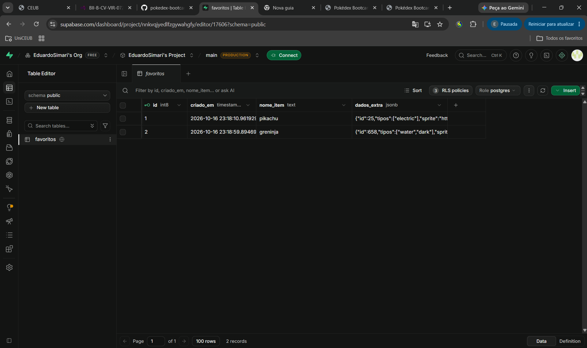
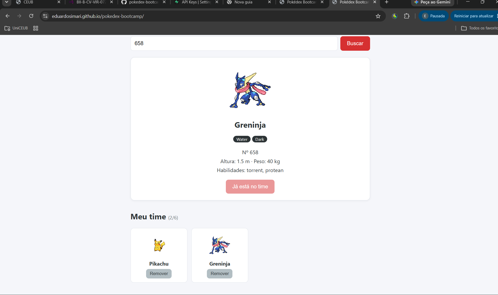
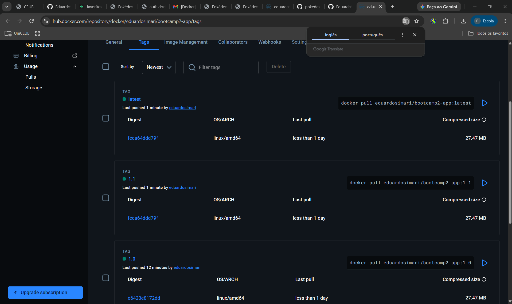
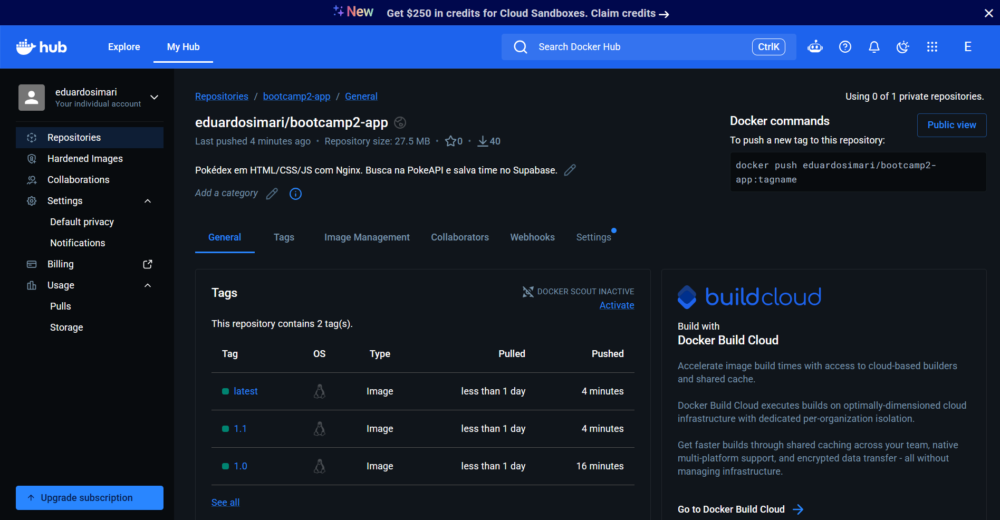
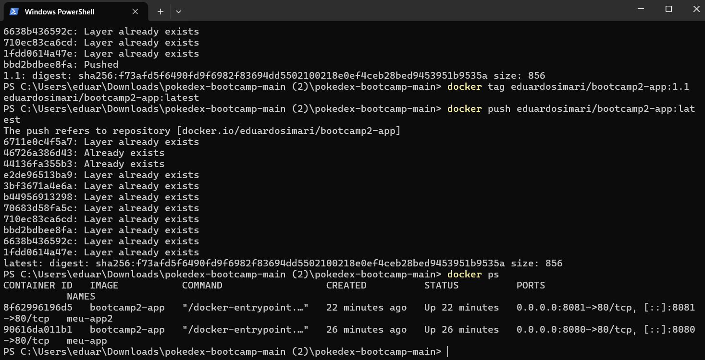

# Pokédex Bootcamp

## Autor
Eduardo Simari — Matrícula 22610027

## Descrição
Pokédex que consulta a PokeAPI e permite montar um time de até 6 Pokémon, salvo em banco de dados (Supabase) para que ele continue lá depois de fechar o navegador. A aplicação também roda em container Docker.

## API utilizada
- PokeAPI — https://pokeapi.co/docs/v2
- Endpoint consumido: `GET https://pokeapi.co/api/v2/pokemon/{nome-ou-id}`

## Funcionalidades
- Buscar Pokémon por nome ou número (botão ou tecla Enter)
- Exibir sprite, número, altura, peso, tipos e habilidades
- Mensagem amigável quando o Pokémon não existe ou a API está fora do ar
- Adicionar o Pokémon ao time (CREATE), limite de 6
- Listar o time ao abrir a página (READ)
- Remover Pokémon do time (DELETE)

## Links
- **Aplicação no ar (GitHub Pages):** https://eduardosimari.github.io/pokedex-bootcamp/
- **Repositório (GitHub):** https://github.com/EduardoSimari/pokedex-bootcamp
- **Imagem no Docker Hub:** https://hub.docker.com/r/eduardosimari/bootcamp2-app

## Como executar localmente
1. Clone: `git clone https://github.com/EduardoSimari/pokedex-bootcamp`
2. Abra o arquivo `index.html` no navegador

## Como executar com Docker (comando para o avaliador)

```bash
docker run -d -p 8080:80 eduardosimari/bootcamp2-app:1.0
```

Depois abra http://localhost:8080

---

## Persistência de dados (Etapa 02)

**Banco escolhido:** Supabase (PostgreSQL), acessado direto do frontend com `supabase-js`.

**Estrutura da tabela `favoritos`:**

| Coluna | Tipo | Descrição |
|---|---|---|
| id | bigint (identity, PK) | identificador do registro |
| criado_em | timestamptz (default now()) | quando foi salvo |
| nome_item | text | nome do Pokémon |
| dados_extra | jsonb | `{ id, sprite, tipos }` do Pokémon |

**O que é salvo:** cada Pokémon adicionado ao time vira uma linha, com nome e dados extras (número, sprite e tipos).

**Segurança (RLS):** a Row Level Security está ativada. Foram criadas políticas para o papel `anon` permitindo `select`, `insert` e `delete`.

> Limitação conhecida: as políticas são abertas, ou seja, qualquer pessoa com a chave anon pode ler e alterar a tabela. Isso é aceitável nesta etapa porque a aplicação não tem login. Em produção, o correto seria autenticar usuários e restringir cada linha ao seu dono.

**Evidências da persistência:**





---

## Sidequests

### SQ1 — `.dockerignore`
O arquivo `.dockerignore` exclui da imagem `.git`, `README.md`, `supabase.sql`, imagens de evidência e arquivos de editor. Eles não são necessários para o Nginx servir o site. Com isso a imagem fica menor, o `docker build` é mais rápido (menos arquivos no contexto de build) e nada sensível ou irrelevante, como o histórico do Git, vai parar dentro do container.

### SQ2 — Versionamento de imagem
Imagem publicada com duas tags: `1.0` (primeira versão funcional) e `1.1` (após uma melhoria no rodapé), além de `latest`.



### SQ3 — Descrição no Docker Hub
A descrição do repositório no Docker Hub explica o que a aplicação é, como rodá-la com `docker run` e quais tecnologias usa.



### SQ4 — Explorando a orquestração
Dois containers da mesma aplicação rodando ao mesmo tempo, nas portas 8080 e 8081:



**Se eu tivesse 100 containers, quem gerenciaria?** Gerenciar 100 containers na mão (subir, reiniciar quando caem, distribuir entre servidores) é inviável. Para isso existe um orquestrador como o **Kubernetes**. Nele, um *cluster* é o conjunto de máquinas que executam os containers. Um *pod* é a menor unidade que o Kubernetes gerencia, e agrupa um ou mais containers que rodam juntos. Uma *réplica* é uma cópia idêntica de um pod: pedimos "quero 100 réplicas" e o Kubernetes mantém esse número, recriando automaticamente as que falharem e balanceando o tráfego entre elas. É a ponte natural do que fizemos com dois containers.
